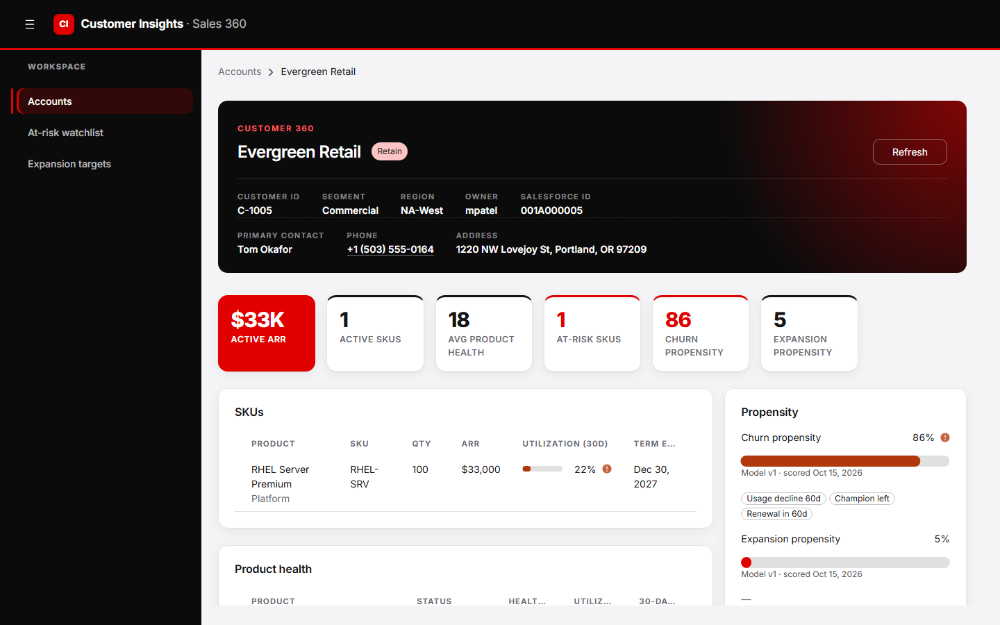
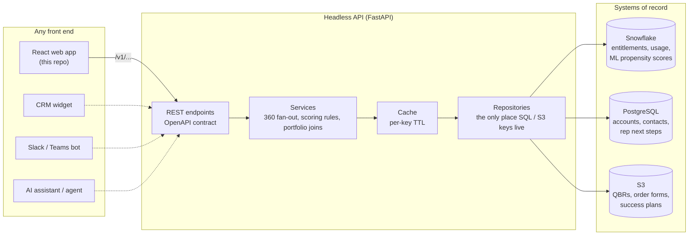
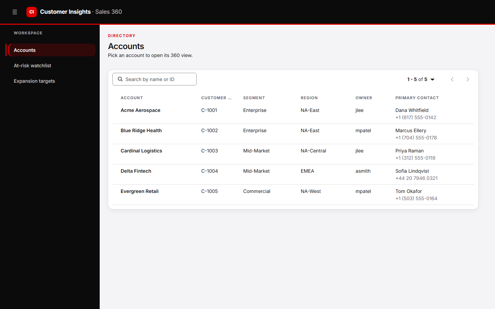
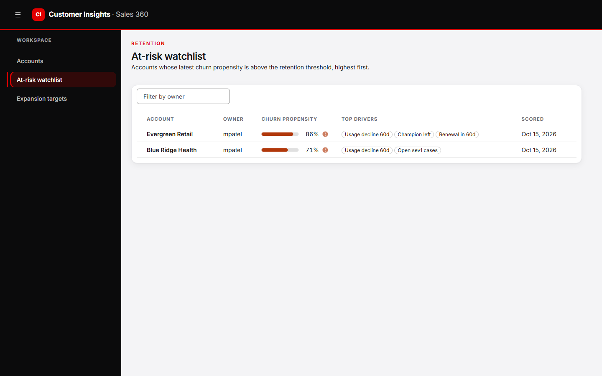
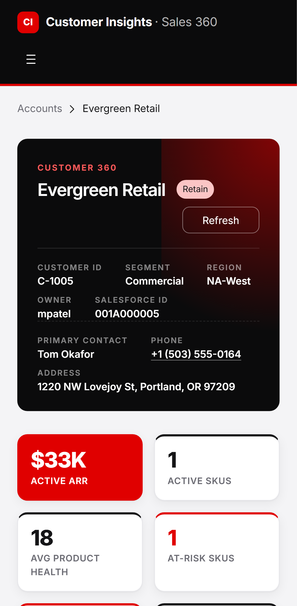
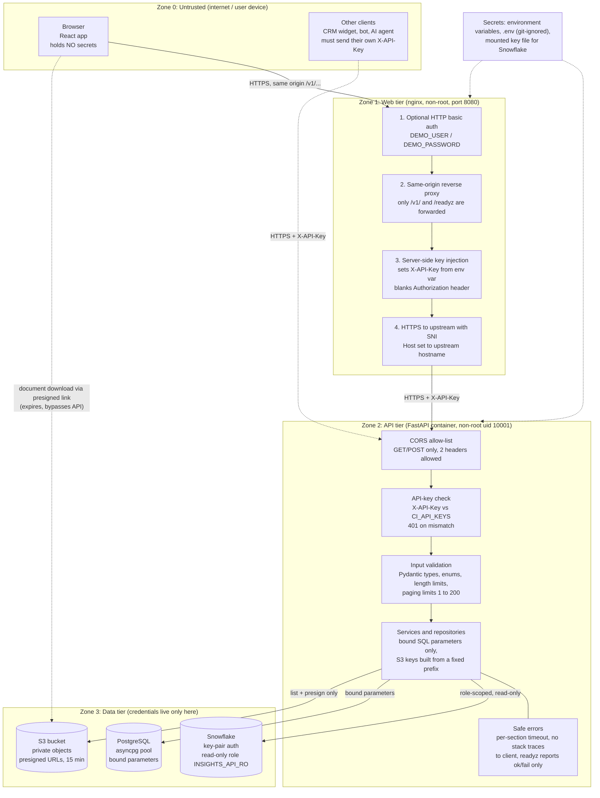

# Headless Application Design: Customer Insights

A **headless sales intelligence platform** that combines data from a data warehouse, an operational database and document storage into one account view for sales reps. It has two parts:

- **A headless API**: a single, typed REST contract that hides three separate back-end systems.
- **A React front end**: one client of that API. It is built to show what the API makes possible, not to be the only way to use it.



---

## Why this exists

Before a customer call, an account rep usually has to check several places:

| Question | Where the answer usually lives |
|---|---|
| What has this customer bought, and when does it renew? | Data warehouse (entitlements) |
| Are they actually using it? | Data warehouse (usage telemetry) |
| Are they likely to leave, or ready to buy more? | Data science models (churn and expansion scores) |
| Who owns the account, and who is our contact there? | CRM or operational database |
| What did we agree in the last review? | Shared drive (slide decks, order forms) |
| What did my team promise to do next? | Notes, email, memory |

Each of these lives in a different tool with a different login. **Customer Insights puts them on one page** and turns the data into a recommendation: **retain**, **expand**, **retain & expand**, or **nurture**.

## What "headless" means here

In a headless design, the business logic and data live behind an API, and **no front end is built into it**. The UI is just one client of that API.



Why this matters:

- **One contract, many surfaces.** The same `/v1/customers/{id}/360` call can drive this web app, a widget inside the CRM, a chat bot, or an AI agent that drafts a call plan. None of them needs to know that Snowflake, Postgres or S3 exist.
- **Back ends can change without breaking clients.** Swap the health-score formula, move account ownership to Salesforce, or replace the ML model, and the API response stays the same.
- **Security by design.** Database credentials and API keys never reach the browser. The front end calls only its own origin, and a proxy (Vite in development, nginx in production) adds the API key on the server side. See [Security](#security) for the full picture.
- **Independent delivery.** The front end and back end can be built, tested and deployed by different teams at different speeds.

## Product tour

| Accounts | At-risk watchlist |
|---|---|
|  |  |

- **Accounts**: search by name or customer ID (partial and case-insensitive). Each row shows the owner and primary contact.
- **Customer 360**: everything about one account from a single API call:
  - **Header**: segment, region, owner, primary contact, phone (tap to call) and address, plus the recommended sales motion.
  - **KPI strip**: active ARR, SKU count, average product health, at-risk SKUs, and churn and expansion scores.
  - **SKUs**: what the customer owns, with ARR, 30-day utilization and term end dates.
  - **Product health**: a 0–100 score per product, blending utilization and 30-day trend.
  - **Propensity**: churn and expansion scores from the ML models, with the top factors behind each score.
  - **Next steps**: the rep's logged actions, and a form to add one.
  - **Documents**: QBRs and order forms, opened through short-lived signed links.
- **At-risk watchlist / Expansion targets**: portfolio views that rank every account by churn or expansion score, filterable by owner.
- **Responsive**: works on a phone, with a slide-out navigation menu.

<p align="center"></p>

## Design decisions

**1. Layered back end, one job per layer.** Each layer depends only on the one below it, so every piece can be tested on its own.

```
Sources       ->  connect / ping / raw fetch for Snowflake, Postgres, S3
Repositories  ->  the only code that knows table names, SQL and S3 keys
Schemas       ->  Pydantic models = the public API contract
Cache         ->  per-key TTL with a lock per key (20 reps, 1 warehouse query)
Services      ->  business rules: 360 fan-out, health and motion logic, joins
API           ->  FastAPI routers, API-key auth, CORS
```

**2. Partial failure instead of total failure.** The 360 page loads its five sections concurrently (`asyncio.gather`), and each one has its own timeout. If the warehouse is suspended or S3 is slow, only that card shows "temporarily unavailable". The rest of the page still loads, and the response names the failed section in an `errors[]` list.

**3. Every source can run "live" or "fake".** Each system can be switched between a real connection and an in-memory fake that behaves the same way, using environment variables. The whole product runs on a laptop with no infrastructure, or with real Postgres and S3 (MinIO) while Snowflake stays fake.

**4. Type safety from database to browser.** The FastAPI OpenAPI spec generates TypeScript types (`openapi-typescript`), and the front end calls the API through a typed client (`openapi-fetch`). If a field is renamed in Python, the UI fails `npm run typecheck` instead of failing quietly in production.

**5. Caching only where it pays.** Warehouse reads are cached with a time limit, because ML scores and usage change daily, not by the second. Postgres reads and writes, such as next steps and contacts, are never cached, so a rep always sees their own changes.

**6. Built on an established design system.** The UI uses PatternFly 6, an open-source enterprise design system, with a custom red, black and white theme. It meets WCAG color-contrast requirements, which the automated tests check.

## Security

This section describes how the application is protected today, where each control lives in the code, and what still needs to be added before real customer data goes through it. It separates **what is implemented** from **what is planned**, so nothing here should be read as a stronger guarantee than the code gives.

### Security architecture

The system is split into four trust zones. Traffic moves one step at a time, and each step has its own control. The browser never talks to the API or to a data store directly (except for downloading a document through a short-lived signed link).



**How to read it.** A request from the browser (1) reaches nginx, which can demand a username and password; (2) is forwarded only if the path is `/v1/` or `/readyz`; (3) gets the API key added by nginx, so the browser never sees it; (4) is checked by the API for origin, key and input shape; (5) reaches the data stores through repositories that use bound parameters and least-privilege credentials. Documents are the one path that skips the API: the API hands back a short-lived signed S3 link and the browser downloads the file directly.

### Controls in detail

| # | Control | What it does | Where |
|---|---|---|---|
| 1 | **Secrets stay server-side** | The API key is added by nginx (production) or the Vite dev proxy (development). It is not in the JavaScript bundle, the browser, or any URL. Database passwords, the Snowflake private key and AWS credentials exist only in the API container's environment. | `web/nginx.conf.template`, `web/vite.config.ts`, `app/config.py` |
| 2 | **API-key authentication** | Every `/v1/*` route requires a valid `X-API-Key`. Several keys can be configured (comma-separated) so a key can be rotated, or given to one integration and revoked on its own. A bad or missing key returns `401`. | `app/api/deps.py`, `CI_API_KEYS` |
| 3 | **Header hygiene at the proxy** | nginx replaces any `X-API-Key` the client sends with its own and clears the `Authorization` header, so a caller cannot pass their own credentials through the proxy. | `web/nginx.conf.template` |
| 4 | **Narrow proxy surface** | The web tier forwards only `/v1/` and `/readyz`. The interactive docs (`/docs`) and `/healthz` are not reachable through the public web origin. | `web/nginx.conf.template` |
| 5 | **CORS allow-list** | Only origins listed in `CI_CORS_ORIGINS` may call the API from a browser. Methods are limited to `GET` and `POST`, and headers to `X-API-Key` and `Content-Type`. Because the UI is served from the same origin as its proxy, production needs no cross-origin access at all. | `app/main.py` |
| 6 | **Input validation** | Request bodies are Pydantic models: `action_type` must be a known value, `note` is 1 to 4,000 characters, `due_date` must be a real date. `limit` is capped at 200 and `offset` cannot be negative. Invalid input is rejected with `422` before any query runs. | `app/schemas.py`, `app/api/customers.py` |
| 7 | **SQL injection prevention** | All Postgres queries are fixed strings with `$1` to `$n` placeholders, and values are bound by `asyncpg`. The Snowflake source also takes bound parameters. User input is never concatenated into SQL. | `app/repositories/postgres_customers.py`, `app/sources/snowflake_source.py` |
| 8 | **Least-privilege data access** | Snowflake runs under `INSIGHTS_API_RO`, which has only `USAGE` and `SELECT` on one schema, and can sign in with a **key pair** instead of a password. The API never writes to Snowflake or S3. Writes are limited to one Postgres table (`rep_actions`). | `sql/snowflake/001_sales_insights.sql`, `app/sources/snowflake_source.py` |
| 9 | **Short-lived document access** | S3 objects stay private. The API lists a customer's objects under a fixed prefix (`customers/{id}/`) and returns presigned `GET` links that expire after `CI_S3_PRESIGN_SECONDS` (default 900 seconds). | `app/repositories/s3_documents.py`, `app/sources/s3_source.py` |
| 10 | **Customer must exist** | Per-customer routes first look the customer up in Postgres and return `404` if it is unknown, so arbitrary IDs are not used to build S3 prefixes or warehouse queries. | `existing_customer` in `app/api/customers.py` |
| 11 | **Hardened containers** | The API runs as a non-root user (uid 10001) on a slim base image. The web image uses `nginx-unprivileged`, runs as uid 101 and listens on port 8080. | `Dockerfile`, `web/Dockerfile` |
| 12 | **Failure isolation** | Each 360 section has its own timeout. A failing back end shows up as one named entry in `errors[]` instead of taking the page down. `/readyz` reports only `name`, `mode` and `ok`. | `app/services/customer360.py`, `app/api/system.py` |
| 13 | **Safe front-end rendering** | React escapes all rendered values and the code never uses `dangerouslySetInnerHTML`. Phone numbers are reduced to digits and `+` before use in a `tel:` link. External document links use `rel="noreferrer"`. | `web/src/pages/` |
| 14 | **Secrets kept out of git** | `.env` is git-ignored and only `.env.example` with placeholders is committed. The Snowflake private key is read from a mounted file path, not from an environment string. | `.gitignore`, `.env.example` |
| 15 | **Optional site login for demos** | Setting `DEMO_USER` and `DEMO_PASSWORD` turns on HTTP basic auth in front of the whole web app. With neither set, the site is open. | `web/15-demo-auth.sh` |

### Threats and how they are handled

| Threat | Mitigation | Status |
|---|---|---|
| API key stolen from the browser | The key is never sent to the browser | Mitigated |
| Unauthenticated direct calls to the API | `401` without a valid key | Mitigated only if `CI_API_KEYS` is set (see limitation 2) |
| SQL injection | Bound parameters, fixed query text | Mitigated |
| Oversized or malformed input | Pydantic validation, length and paging limits | Mitigated |
| Cross-site requests from other websites | CORS allow-list; no cookies or ambient credentials are used | Mitigated |
| Cross-site scripting | React escaping, no raw HTML injection | Mitigated |
| Leaked database or warehouse credentials | Read-only Snowflake role, key-pair option, secrets outside git | Partly mitigated |
| A shared document link being reused | 15-minute expiry on presigned URLs | Partly mitigated (a link works for anyone who has it until it expires) |
| One back end failing or being slow | Per-section timeouts and partial results | Mitigated |
| A rep seeing accounts that are not theirs | Not enforced yet | **Open** (roadmap: SSO and book-of-business filtering) |

### Known limitations

These are gaps in the current code. They are acceptable for a local or demo deployment and **should be closed before production use with real customer data**.

1. **No per-user identity or authorization.** The API key identifies a *client application*, not a person. Every caller with the key can read every account and add actions to any customer. `created_by` on a next step is supplied by the caller and is not verified.
2. **Authentication fails open.** If `CI_API_KEYS` is empty, the API accepts all requests. The shipped `.env.example` uses the placeholder key `dev-key-change-me`, which must be replaced in any shared environment.
3. **The web origin is a gateway to the API.** Because nginx adds the key to every request, anyone who can reach the web tier can use the API through it. In production the web tier needs its own sign-in. The demo basic-auth switch is a stopgap, and it writes the password unhashed to a temp file inside the container.
4. **API keys are checked with a plain set lookup** and are not rate-limited, so there is no brute-force throttling or constant-time comparison.
5. **No TLS or security headers in the repo itself.** TLS is expected from the hosting platform (for example Cloud Run or a load balancer). nginx does not yet set `Content-Security-Policy`, `X-Content-Type-Options`, `Referrer-Policy` or `Strict-Transport-Security`.
6. **`/readyz` is public.** It shows which back-end systems exist, their mode (`live` or `fake`) and whether each is healthy. The cache-clear endpoint `/v1/admin/cache/clear` is protected only by the same API key as every other route.
7. **Search wildcards are not escaped.** `%` and `_` typed into the account search act as `ILIKE` wildcards. This cannot change the query, only broaden matches.
8. **Sample credentials in Docker Compose.** Postgres (`insights/insights`) and MinIO (`minioadmin`) use throwaway passwords and publish their ports to the host. That file is for local development only.
9. **No audit log.** Reads and writes are not recorded per user, and there is no request-ID tracing.
10. **Dependencies are not scanned automatically** (no Dependabot, `pip-audit` or `npm audit` in CI).

### Hardening roadmap

In priority order:

1. **SSO with OIDC/JWT.** Validate a signed token in a FastAPI dependency, take `created_by` from the token instead of the request body, and filter `/customers` and `/portfolio` by the caller's book of business.
2. **Fail closed.** Refuse to start, or reject all requests, when no API key or token validator is configured outside local mode.
3. **Protect the web tier.** Put the web app behind SSO (for example Identity-Aware Proxy on Cloud Run) so the nginx key injection is not an open door.
4. **Add response security headers** in nginx, including a restrictive Content-Security-Policy.
5. **Rate limiting and constant-time key comparison** (`secrets.compare_digest`), with keys stored hashed.
6. **Secret management.** Move keys and credentials to a secret manager (Google Secret Manager or AWS Secrets Manager) and rotate them on a schedule.
7. **Audit logging** of who read or changed which account, sent to a central log store.
8. **Network isolation.** Put the databases on a private network, make the API reachable only from the web tier, and require TLS for the Postgres connection.
9. **CI security checks:** dependency audit, container image scanning and secret scanning.

## Tech stack

| Layer | Technology |
|---|---|
| API | Python 3.12, FastAPI, Pydantic v2, Uvicorn |
| Data access | `snowflake-connector-python`, `asyncpg`, `boto3` |
| Front end | React 19, TypeScript, Vite, PatternFly 6, TanStack Query, React Router |
| API contract | OpenAPI → `openapi-typescript` → `openapi-fetch` |
| Testing | pytest + httpx (API), Playwright + axe-core (end-to-end and accessibility) |
| Packaging | Docker, Docker Compose, nginx |

## Quality: tested end to end

| Suite | What it covers | Result |
|---|---|---|
| `pytest` | Endpoints, auth, search, contacts, 360 assembly, partial failures, portfolio joins | 15 passing |
| Playwright | 39 user scenarios, each run at **desktop and mobile** sizes: search, navigation, Customer 360, logging a next step, watchlists and filters, simulated API outages, theme, no horizontal scroll, and **axe accessibility scans** of every screen | 78 passing |

The Playwright suite fails any test that logs a browser console error, so silent front-end errors are caught.

## Run it locally

You need **Python 3.10+** and **Node 20+**. No database or cloud account is required, because all data sources start in fake mode with sample data.

**1. API** (terminal 1)

```bash
python -m venv .venv
# Windows: .venv\Scripts\activate    macOS/Linux: source .venv/bin/activate
pip install -r requirements-dev.txt
uvicorn app.main:app --reload
```

Interactive API docs are at http://localhost:8000/docs.

**2. Web app** (terminal 2)

```bash
cd web
cp .env.example .env
npm install
npm run dev
```

Open http://localhost:3000.

**3. Tests**

```bash
pytest -q                                   # API tests (from the repo root)
cd web && npx playwright install chromium   # first time only
npm run test:e2e                            # end-to-end tests (API and web app must be running)
```

**With Docker** (real Postgres and MinIO for S3, fake Snowflake):

```bash
cp .env.example .env
docker compose up --build
```

## API at a glance

| Method | Path | Purpose |
|---|---|---|
| GET | `/v1/customers?search=&region=&owner=` | Account search and paging |
| GET | `/v1/customers/{id}/360` | The whole account page in one call |
| GET | `/v1/customers/{id}/skus`, `/product-health`, `/propensity`, `/documents` | Individual sections |
| GET / POST | `/v1/customers/{id}/actions` | Rep next steps |
| GET | `/v1/portfolio/at-risk`, `/v1/portfolio/expansion` | Ranked watchlists |
| GET | `/healthz`, `/readyz` | Liveness, and readiness checked per data source |

The full endpoint list, the Snowflake objects and the data-model notes are in **[docs/TECHNICAL.md](docs/TECHNICAL.md)**.

## Project structure

```
app/
  sources/        connections to Snowflake, Postgres, S3
  repositories/   SQL / S3 access + in-memory fakes
  services/       360 fan-out, portfolio joins, cached insights
  api/            FastAPI routers
  schemas.py      the API contract
sql/              Postgres schema + seed, Snowflake views
tests/            pytest API tests
web/
  src/api/        generated types, typed client, query hooks
  src/pages/      Accounts, Watchlists, Customer 360
  e2e/            Playwright tests
docs/             technical guide and screenshots
```

## Roadmap

- Sign-in with SSO (OIDC/JWT), with each rep seeing only their own book of business
- Redis cache for running more than one API instance
- Deployment to Google Cloud Run (API and web as separate services)
- An AI-generated account brief ("what changed since the last QBR?") built on the same 360 endpoint, to show a non-UI client of the headless API

---

*All customer names, contacts, phone numbers (555 test range) and figures in this repository are fictional sample data. The product names in the sample catalog are used only for illustration. This project is not affiliated with or endorsed by any vendor.*
