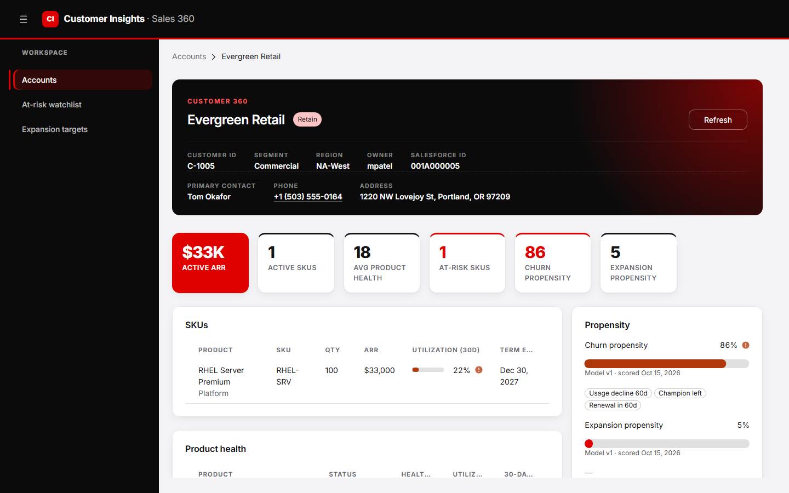
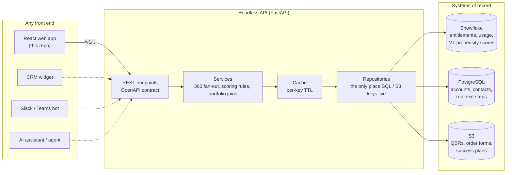
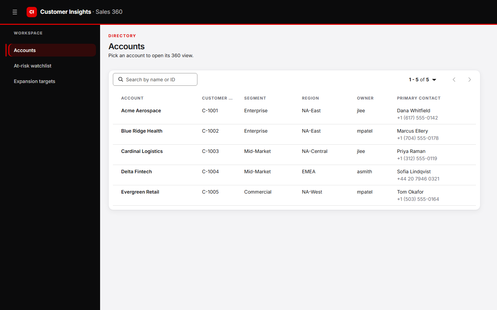
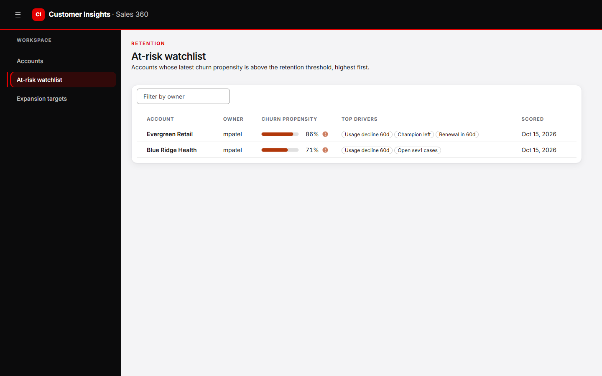
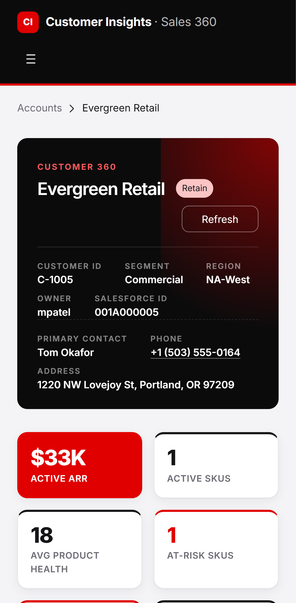

# Headless Application Design: Customer Insights

A **headless sales intelligence platform** that combines data from a data warehouse, an operational database and document storage into one account view for sales reps. It has two parts:

- **A headless API**: a single, typed REST contract that hides three separate back-end systems.
- **A React front end**: one client of that API. It is built to show what the API makes possible, not to be the only way to use it.



---

## Why this exists

Before a customer call, an account rep usually has to check several places:

| Question | Where the answer usually lives |
|---|---|
| What has this customer bought, and when does it renew? | Data warehouse (entitlements) |
| Are they actually using it? | Data warehouse (usage telemetry) |
| Are they likely to leave, or ready to buy more? | Data science models (churn and expansion scores) |
| Who owns the account, and who is our contact there? | CRM or operational database |
| What did we agree in the last review? | Shared drive (slide decks, order forms) |
| What did my team promise to do next? | Notes, email, memory |

Each of these lives in a different tool with a different login. **Customer Insights puts them on one page** and turns the data into a recommendation: **retain**, **expand**, **retain & expand**, or **nurture**.

## What "headless" means here

In a headless design, the business logic and data live behind an API, and **no front end is built into it**. The UI is just one client of that API.



Why this matters:

- **One contract, many surfaces.** The same `/v1/customers/{id}/360` call can drive this web app, a widget inside the CRM, a chat bot, or an AI agent that drafts a call plan. None of them needs to know that Snowflake, Postgres or S3 exist.
- **Back ends can change without breaking clients.** Swap the health-score formula, move account ownership to Salesforce, or replace the ML model, and the API response stays the same.
- **Security by design.** Database credentials and API keys never reach the browser. The front end calls only its own origin, and a proxy (Vite in development, nginx in production) adds the API key on the server side.
- **Independent delivery.** The front end and back end can be built, tested and deployed by different teams at different speeds.

## Product tour

| Accounts | At-risk watchlist |
|---|---|
|  |  |

- **Accounts**: search by name or customer ID (partial and case-insensitive). Each row shows the owner and primary contact.
- **Customer 360**: everything about one account from a single API call:
  - **Header**: segment, region, owner, primary contact, phone (tap to call) and address, plus the recommended sales motion.
  - **KPI strip**: active ARR, SKU count, average product health, at-risk SKUs, and churn and expansion scores.
  - **SKUs**: what the customer owns, with ARR, 30-day utilization and term end dates.
  - **Product health**: a 0–100 score per product, blending utilization and 30-day trend.
  - **Propensity**: churn and expansion scores from the ML models, with the top factors behind each score.
  - **Next steps**: the rep's logged actions, and a form to add one.
  - **Documents**: QBRs and order forms, opened through short-lived signed links.
- **At-risk watchlist / Expansion targets**: portfolio views that rank every account by churn or expansion score, filterable by owner.
- **Responsive**: works on a phone, with a slide-out navigation menu.

<p align="center"></p>

## Design decisions

**1. Layered back end, one job per layer.** Each layer depends only on the one below it, so every piece can be tested on its own.

```
Sources       ->  connect / ping / raw fetch for Snowflake, Postgres, S3
Repositories  ->  the only code that knows table names, SQL and S3 keys
Schemas       ->  Pydantic models = the public API contract
Cache         ->  per-key TTL with a lock per key (20 reps, 1 warehouse query)
Services      ->  business rules: 360 fan-out, health and motion logic, joins
API           ->  FastAPI routers, API-key auth, CORS
```

**2. Partial failure instead of total failure.** The 360 page loads its five sections concurrently (`asyncio.gather`), and each one has its own timeout. If the warehouse is suspended or S3 is slow, only that card shows "temporarily unavailable". The rest of the page still loads, and the response names the failed section in an `errors[]` list.

**3. Every source can run "live" or "fake".** Each system can be switched between a real connection and an in-memory fake that behaves the same way, using environment variables. The whole product runs on a laptop with no infrastructure, or with real Postgres and S3 (MinIO) while Snowflake stays fake.

**4. Type safety from database to browser.** The FastAPI OpenAPI spec generates TypeScript types (`openapi-typescript`), and the front end calls the API through a typed client (`openapi-fetch`). If a field is renamed in Python, the UI fails `npm run typecheck` instead of failing quietly in production.

**5. Caching only where it pays.** Warehouse reads are cached with a time limit, because ML scores and usage change daily, not by the second. Postgres reads and writes, such as next steps and contacts, are never cached, so a rep always sees their own changes.

**6. Built on an established design system.** The UI uses PatternFly 6, an open-source enterprise design system, with a custom red, black and white theme. It meets WCAG color-contrast requirements, which the automated tests check.

## Tech stack

| Layer | Technology |
|---|---|
| API | Python 3.12, FastAPI, Pydantic v2, Uvicorn |
| Data access | `snowflake-connector-python`, `asyncpg`, `boto3` |
| Front end | React 19, TypeScript, Vite, PatternFly 6, TanStack Query, React Router |
| API contract | OpenAPI → `openapi-typescript` → `openapi-fetch` |
| Testing | pytest + httpx (API), Playwright + axe-core (end-to-end and accessibility) |
| Packaging | Docker, Docker Compose, nginx |

## Quality: tested end to end

| Suite | What it covers | Result |
|---|---|---|
| `pytest` | Endpoints, auth, search, contacts, 360 assembly, partial failures, portfolio joins | 15 passing |
| Playwright | 39 user scenarios, each run at **desktop and mobile** sizes: search, navigation, Customer 360, logging a next step, watchlists and filters, simulated API outages, theme, no horizontal scroll, and **axe accessibility scans** of every screen | 78 passing |

The Playwright suite fails any test that logs a browser console error, so silent front-end errors are caught.

## Run it locally

You need **Python 3.10+** and **Node 20+**. No database or cloud account is required, because all data sources start in fake mode with sample data.

**1. API** (terminal 1)

```bash
python -m venv .venv
# Windows: .venv\Scripts\activate    macOS/Linux: source .venv/bin/activate
pip install -r requirements-dev.txt
uvicorn app.main:app --reload
```

Interactive API docs are at http://localhost:8000/docs.

**2. Web app** (terminal 2)

```bash
cd web
cp .env.example .env
npm install
npm run dev
```

Open http://localhost:3000.

**3. Tests**

```bash
pytest -q                                   # API tests (from the repo root)
cd web && npx playwright install chromium   # first time only
npm run test:e2e                            # end-to-end tests (API and web app must be running)
```

**With Docker** (real Postgres and MinIO for S3, fake Snowflake):

```bash
cp .env.example .env
docker compose up --build
```

## API at a glance

| Method | Path | Purpose |
|---|---|---|
| GET | `/v1/customers?search=&region=&owner=` | Account search and paging |
| GET | `/v1/customers/{id}/360` | The whole account page in one call |
| GET | `/v1/customers/{id}/skus`, `/product-health`, `/propensity`, `/documents` | Individual sections |
| GET / POST | `/v1/customers/{id}/actions` | Rep next steps |
| GET | `/v1/portfolio/at-risk`, `/v1/portfolio/expansion` | Ranked watchlists |
| GET | `/healthz`, `/readyz` | Liveness, and readiness checked per data source |

The full endpoint list, the Snowflake objects and the data-model notes are in **[docs/TECHNICAL.md](docs/TECHNICAL.md)**.

## Project structure

```
app/
  sources/        connections to Snowflake, Postgres, S3
  repositories/   SQL / S3 access + in-memory fakes
  services/       360 fan-out, portfolio joins, cached insights
  api/            FastAPI routers
  schemas.py      the API contract
sql/              Postgres schema + seed, Snowflake views
tests/            pytest API tests
web/
  src/api/        generated types, typed client, query hooks
  src/pages/      Accounts, Watchlists, Customer 360
  e2e/            Playwright tests
docs/             technical guide and screenshots
```

## Roadmap

- Sign-in with SSO (OIDC/JWT), with each rep seeing only their own book of business
- Redis cache for running more than one API instance
- Deployment to Google Cloud Run (API and web as separate services)
- An AI-generated account brief ("what changed since the last QBR?") built on the same 360 endpoint, to show a non-UI client of the headless API

---

*All customer names, contacts, phone numbers (555 test range) and figures in this repository are fictional sample data. The product names in the sample catalog are used only for illustration. This project is not affiliated with or endorsed by any vendor.*
